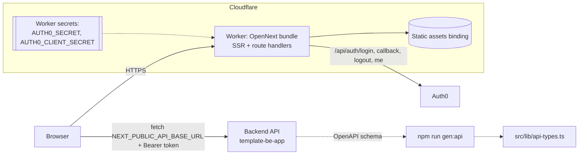
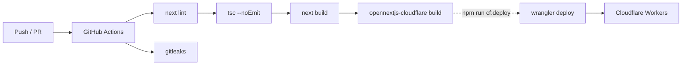

# template-fe-app

[](https://github.com/Anie3142/template-fe-app/actions/workflows/ci.yml)

A **Next.js 14 (App Router) + TypeScript** frontend template that deploys to the edge on
**Cloudflare Workers** through the [OpenNext Cloudflare adapter](https://opennext.js.org/cloudflare).
It ships with server-side Auth0, shadcn/ui, a persisted TanStack Query cache, a typed API
client generated from the backend's OpenAPI schema, and Playwright E2E scaffolding.

It is the frontend half of a pair. The backend half is
[`template-be-app`](https://github.com/Anie3142/template-be-app) (Django/DRF on AWS ECS),
and the two are designed to run side by side locally with a single `docker compose` command.

## What this template gives you

| Area | Included |
|---|---|
| Runtime | Next.js 14 App Router on Cloudflare Workers via OpenNext; no Node server to run |
| Auth | Server-side Auth0 (`handleAuth()` route handlers, encrypted session cookie); dev bypass for local/E2E |
| Data | TanStack Query with a persisted, versioned `localStorage` cache; typed `apiFetch<T>` |
| API contract | `openapi-typescript` types generated from the backend's OpenAPI schema |
| UI | Tailwind, shadcn/ui primitives, lazy-loaded Recharts charts and Radix dialogs |
| Quality gates | GitHub Actions: lint, typecheck, `next build`, Workers bundle build, gitleaks |
| Developer experience | `make` targets, pre-commit hooks, Playwright scaffold, dev container for the full stack |

Design decisions are recorded as ADRs in [`docs/adr/`](docs/adr/):
[Workers via OpenNext](docs/adr/0001-nextjs-on-cloudflare-workers-via-opennext.md) ·
[Auth0 server-side sessions](docs/adr/0002-auth0-server-side-sessions.md) ·
[env & secrets](docs/adr/0003-environment-and-secrets-handling.md) ·
[data layer](docs/adr/0004-data-layer-tanstack-query-and-openapi-types.md).

## Highlights

- **Edge deployment without a Node server.** `@opennextjs/cloudflare` compiles the Next.js
  build into a Worker (`.open-next/worker.js`) plus static assets, and `wrangler deploy` ships it.
- **Secrets never touch the repo.** Public config lives in `wrangler.toml [vars]`, and
  `AUTH0_SECRET` / `AUTH0_CLIENT_SECRET` go through `wrangler secret put`.
- **Contract-first API types.** `npm run gen:api` regenerates `src/lib/api-types.ts` from the
  backend's drf-spectacular schema with `openapi-typescript`.
- **Performance defaults:** charts (Recharts) and modals are code-split with `next/dynamic`,
  the query cache persists to `localStorage` with a version buster, and search inputs use a
  debounce hook.
- **CI that also proves the edge bundle builds:** lint, typecheck, `next build`, the
  OpenNext Workers bundle, and gitleaks on every PR.

## Stack

| Concern | Choice |
|---|---|
| Framework | Next.js 14 App Router, React 18, TypeScript (strict) |
| UI | Tailwind CSS 3, shadcn/ui (Radix primitives), lucide-react, Recharts |
| Data | TanStack Query v5 + sync-storage persister |
| Auth | `@auth0/nextjs-auth0` v3 (server-side route handlers) |
| API types | `openapi-typescript` |
| Hosting | Cloudflare Workers via `@opennextjs/cloudflare` + Wrangler 4 |
| Tests | Playwright (Chromium) |
| CI | GitHub Actions |

## Architecture



Build and deploy flow:



## Project layout

```
.
├── .github/workflows/ci.yml       # Lint, typecheck, build, Workers bundle, gitleaks
├── wrangler.toml                  # Worker name, assets binding, public [vars]
├── open-next.config.ts            # OpenNext adapter overrides (cloudflare-node / edge)
├── next.config.js
├── Makefile                       # dev / lint / typecheck / test / build / cf-build / scan
├── .pre-commit-config.yaml        # eslint, tsc, gitleaks
├── docs/adr/                      # Architecture decision records
├── Dockerfile.dev                 # Dev container used by the backend's compose "full" profile
├── playwright.config.ts
├── components.json                # shadcn/ui config
├── src/
│   ├── app/
│   │   ├── layout.tsx             # Wraps the tree in <Providers>
│   │   ├── page.tsx               # Landing page with Auth0 login/logout
│   │   └── api/auth/[auth0]/route.ts   # handleAuth(): login, logout, callback, me
│   ├── components/
│   │   ├── providers.tsx          # Auth0 UserProvider + persisted QueryClient
│   │   ├── ui/                    # shadcn/ui primitives (button, skeleton)
│   │   ├── charts/                # Recharts wrappers, lazy-loaded
│   │   └── modals/                # Radix Dialog wrappers, lazy-loaded
│   ├── hooks/useDebouncedValue.ts
│   └── lib/
│       ├── api-client.ts          # apiFetch<T>(): typed fetch with optional Bearer token
│       ├── api-types.ts           # Generated from the backend OpenAPI schema
│       └── utils.ts               # cn() class merger
└── tests/e2e/                     # Playwright smoke test + dev-bypass helper
```

## Local development

Prerequisites: Node.js 20+.

```bash
cp .env.example .env.local
npm ci
npm run dev            # http://localhost:3000
```

The dev server boots with the placeholder Auth0 values. Auth0 is only contacted when
someone hits `/api/auth/login`. Point `NEXT_PUBLIC_API_BASE_URL` at a running backend
(the default is `http://localhost:8000/api/v1`).

**Full stack in containers:** check out `template-be-app` as `../backend` and this repo as
`../frontend`, then run `docker compose --profile full up` from the backend. That starts
PostgreSQL, Django and this app (via `Dockerfile.dev`) with hot reload. Anonymous volumes
for `/app/node_modules` and `/app/.next` stop the host's native modules and build cache
from clobbering the container's.

`make help` lists the Make targets (`make test` = lint + typecheck, `make build`,
`make cf-build`). `pre-commit install` enables the hooks in `.pre-commit-config.yaml`.

Useful scripts:

| Script | What it does |
|---|---|
| `npm run lint` / `npm run typecheck` | ESLint (next/core-web-vitals) / `tsc --noEmit` |
| `npm run build` | Standard Next.js production build |
| `npm run test:e2e` | Playwright against `http://localhost:3000` |
| `npm run gen:api` | Regenerate API types from `../backend/schema.yaml` |
| `npm run cf:build` | Build the Cloudflare Worker bundle into `.open-next/` |
| `npm run cf:preview` | Run the Worker locally with `wrangler dev` |
| `npm run cf:deploy` | Build and `wrangler deploy` |

To refresh the schema from a running backend container:

```bash
(cd ../backend && docker compose exec web python manage.py spectacular --file schema.yaml)
npm run gen:api
```

## CI/CD

**GitHub Actions** (`.github/workflows/ci.yml`) runs on pushes to `main` and on pull requests:

1. `npm ci` (lockfile-exact install, npm cache)
2. `npm run lint`
3. `npm run typecheck`
4. `npm run build`
5. `npm run cf:build`, which proves the OpenNext Workers bundle compiles (nothing is deployed)
6. gitleaks secret scan over the full history (separate job)

**Deployment** is a deliberate, explicit step: `npm run cf:deploy` runs the OpenNext build
and `wrangler deploy` with the Worker name and assets binding from `wrangler.toml`.
To bind a custom hostname, uncomment the `[[routes]]` block (the API token needs
*Zone > Workers Routes > Edit*). Per-environment API URLs use `[env.<name>.vars]` blocks
and `wrangler deploy --env <name>`.

## Configuration

| Variable | Where it lives | Purpose |
|---|---|---|
| `NEXT_PUBLIC_API_BASE_URL` | `.env.local` (dev), `wrangler.toml [vars]` (prod) | Backend base URL. Public, inlined into the client bundle. |
| `NEXT_PUBLIC_DEV_AUTH_BYPASS` | `.env.local` | Pairs with the backend's `DEV_AUTH_BYPASS` for Playwright and local runs |
| `AUTH0_SECRET` | `.env.local` / `wrangler secret put` | Session cookie encryption key (`openssl rand -hex 32`) |
| `AUTH0_BASE_URL` | `.env.local` / Worker vars | This app's public URL |
| `AUTH0_ISSUER_BASE_URL` | `.env.local` / Worker vars | `https://<tenant>.auth0.com` |
| `AUTH0_CLIENT_ID` | `.env.local` / Worker vars | Auth0 application client ID |
| `AUTH0_CLIENT_SECRET` | `.env.local` / `wrangler secret put` | Auth0 application secret |
| `AUTH0_AUDIENCE` | `.env.local` / Worker vars | Backend API identifier, matching the backend's `AUTH0_API_AUDIENCE` |

`NEXT_PUBLIC_*` values are inlined at build time, so restart `npm run dev` (or rebuild)
after changing them.

## Security notes

- `.env`, `.env.local`, `.dev.vars` and `.wrangler/` are git-ignored. Only `.env.example`
  with placeholders is committed, and gitleaks runs in CI.
- Server secrets (`AUTH0_SECRET`, `AUTH0_CLIENT_SECRET`) are stored as encrypted Worker
  secrets, never in `wrangler.toml`, whose `[vars]` block is public by design.
- The Auth0 flow runs server-side (`handleAuth()` route handlers), so the client secret
  never reaches the browser. The session is an encrypted cookie.
- Only successful queries are persisted to `localStorage`, and a `PERSIST_BUSTER` version
  invalidates cached shapes after breaking API changes. Treat anything cached there as
  user-visible.
- `NEXT_PUBLIC_DEV_AUTH_BYPASS` is a local/test convenience. Leave it unset in production.

## Production checklist

Before the first real deploy of an app created from this template:

- [ ] Worker `name` in `wrangler.toml` set to the app's name.
- [ ] `NEXT_PUBLIC_API_BASE_URL` in `wrangler.toml [vars]` points at the real API
      (the code falls back to `localhost` when it is unset).
- [ ] `AUTH0_SECRET` and `AUTH0_CLIENT_SECRET` set with `wrangler secret put`.
- [ ] `AUTH0_BASE_URL`, `AUTH0_ISSUER_BASE_URL`, `AUTH0_CLIENT_ID` set; Auth0 app's
      callback and logout URLs include the production hostname.
- [ ] `AUTH0_AUDIENCE` equals the backend's `AUTH0_API_AUDIENCE`.
- [ ] `NEXT_PUBLIC_DEV_AUTH_BYPASS` unset in production (and `DEV_AUTH_BYPASS` off on the backend).
- [ ] Backend `CORS_ALLOWED_ORIGINS` includes this app's origin.
- [ ] `[[routes]]` custom domain enabled, with an API token that has *Zone > Workers Routes > Edit*.
- [ ] `PERSIST_BUSTER` bumped after any breaking API shape change.
- [ ] `npm run cf:preview` checked locally before `npm run cf:deploy`.

## License

[MIT](LICENSE) © Aniebiet-Abasi Udo
